# ha-dns-filter-card

[](https://www.home-assistant.io/integrations/marketplace/)
[](https://github.com/juju35/ha-dns-filter-card/actions/workflows/hacs.yml)
[](https://github.com/juju35/ha-dns-filter-card/actions/workflows/validate.yml)
[](https://github.com/juju35/ha-dns-filter-card/actions/workflows/lint.yml)
[](https://github.com/juju35/ha-dns-filter-card/releases/latest)
[](https://github.com/juju35/ha-dns-filter-card/blob/main/LICENSE)
[](https://buymeacoffee.com/julienstep9)

<p align="center">
  &nbsp;&nbsp;
  
</p>

Lovelace cards for Home Assistant to monitor and control your DNS filter — [AdGuard Home](https://adguard.com/adguard-home/overview.html) or [Pi-hole](https://pi-hole.net): DNS queries, blocked queries, blocked ratio, protection status, settings switches and pause at a glance.

The cards are built on top of the [AdGuard Home](https://www.home-assistant.io/integrations/adguard/) and [Pi-hole](https://www.home-assistant.io/integrations/pi_hole/) integrations included in Home Assistant: entities are **discovered automatically**, you don't have to pick them one by one, and it works whatever your Home Assistant language.

[](https://my.home-assistant.io/redirect/marketplace_repository/?owner=juju35&repository=ha-dns-filter-card&category=plugin)

|  AdGuard Home |  Pi-hole |
|---|---|
| <picture><source media="(prefers-color-scheme: dark)" srcset="https://raw.githubusercontent.com/juju35/ha-dns-filter-card/main/screenshots/card-adguard-dark.png">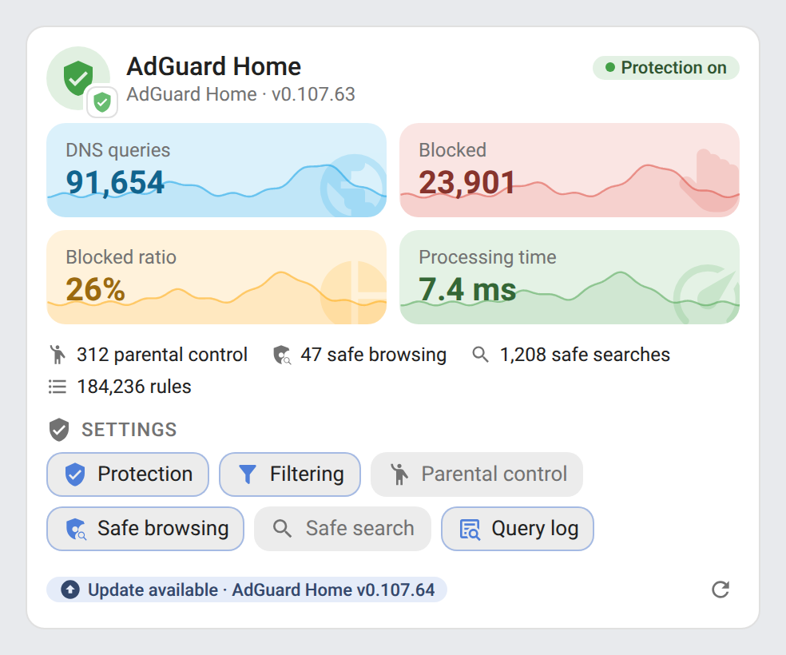</picture> | <picture><source media="(prefers-color-scheme: dark)" srcset="https://raw.githubusercontent.com/juju35/ha-dns-filter-card/main/screenshots/card-pihole-dark.png">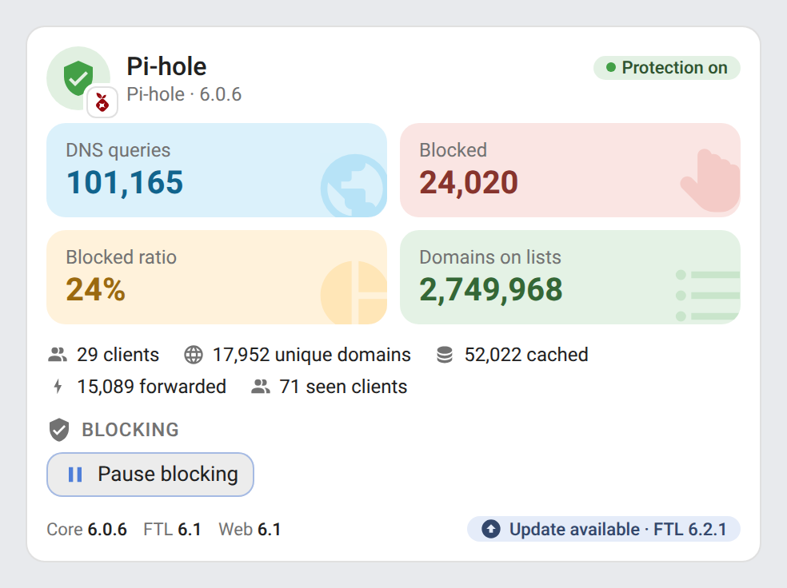</picture> |
| <picture><source media="(prefers-color-scheme: dark)" srcset="https://raw.githubusercontent.com/juju35/ha-dns-filter-card/main/screenshots/mini-card-adguard-dark.png">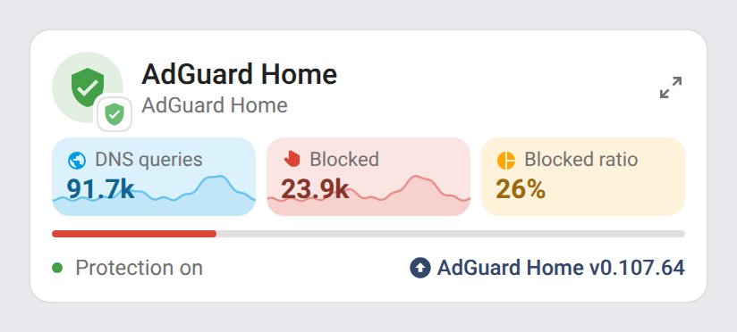</picture> | <picture><source media="(prefers-color-scheme: dark)" srcset="https://raw.githubusercontent.com/juju35/ha-dns-filter-card/main/screenshots/mini-card-pihole-dark.png">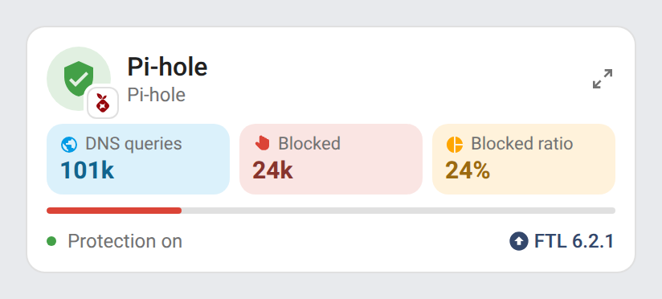</picture> |

## Features

- Two cards: a full **DNS Filter Card** and a compact **DNS Filter Mini Card**, of type `custom:dns-filter-card` and `custom:dns-filter-mini-card`
- Two integrations: **AdGuard Home** and **Pi-hole** — automatic discovery, several instances supported, both can be mixed
- Four statistics tiles, one tint each: DNS queries, blocked queries, blocked ratio, and the average processing time (AdGuard Home) or the domains on the block lists (Pi-hole); each tile draws its last 24 hours behind it (recorder statistics, where the sensor keeps them)
- Detail counters: parental control, safe browsing and safe search blocks and the rules count (AdGuard Home); clients, unique domains, cached and forwarded queries, seen clients (Pi-hole)
- Status pill: protection on, protection off (AdGuard Home) or paused (Pi-hole), grey when unavailable; a click turns the AdGuard Home protection on or off, or pauses / resumes Pi-hole blocking
- AdGuard Home: the six setting switches as glass chips (protection, filtering, parental control, safe browsing, safe search, query log), a click toggles them; a refresh button updates the filter lists
- Pi-hole: a **pause** button opens a durations popup at the top of the card (5 min, 15 min, 30 min, 1 h, 2 h, or until resumed), a **resume** button while blocking is paused
- Versions in the footer (Core, FTL and web interface for Pi-hole) and an « Update available » chip for each pending update (click for its more-info dialog, where it can be installed)
- Detail button on the mini card (top right): it switches the mini card to the full card's content and back; a click anywhere outside the card brings the compact view back
- Click any value to open its Home Assistant history (more-info dialog)
- Round shield icon next to the name, in the status color, with the AdGuard or Pi-hole mark as a badge: a click opens the web interface of the instance (or the project's website when Home Assistant knows no address)
- Visual editor in the dashboard UI for both cards (no YAML needed)
- Light and dark mode, English, French, German, Spanish, Serbian (Cyrillic and Latin), Italian, Dutch, European Portuguese, Polish, Romanian, Danish, Swedish, Bulgarian, Russian, Ukrainian, Hungarian, Slovak, Czech, Slovenian, Latvian and Greek
- Single file, no external dependency

## Supported integrations

| Integration | What the cards show |
|---|---|
| [AdGuard Home](https://www.home-assistant.io/integrations/adguard/) (built in) | DNS queries, blocked, blocked ratio, average processing time, parental control / safe browsing / safe search counters, rules count (sensor disabled by default), protection status, the six setting switches, filter lists refresh, AdGuard Home version and update |
| [Pi-hole](https://www.home-assistant.io/integrations/pi_hole/) (built in, v5 and v6) | DNS queries, blocked, blocked ratio, domains on lists, clients, unique domains, cached and forwarded queries, seen clients, blocking status, pause / resume, Core / FTL / Web versions and updates |

Several instances are supported, and the two integrations can be mixed: pick the instance in the visual editor.

## Prerequisites

Home Assistant 2024.8 or later, and at least one of:

- the [AdGuard Home integration](https://www.home-assistant.io/integrations/adguard/) (included in Home Assistant)
- the [Pi-hole integration](https://www.home-assistant.io/integrations/pi_hole/) (included in Home Assistant)

## Installation

### Via the Marketplace (recommended)

Click the button below to add the repository directly:

[](https://my.home-assistant.io/redirect/marketplace_repository/?owner=juju35&repository=ha-dns-filter-card&category=plugin)

Then click **Install**, and reload your browser when the Marketplace asks you to.

Or manually:

1. Open **Settings → Marketplace → Add from link** (top right; this needs a GitHub account connected)
2. Add `https://github.com/juju35/ha-dns-filter-card` — Type: **Dashboard**
3. Open **DNS Filter Card** and click **Install**
4. Clear your browser cache and refresh

### Manual

1. Download `dns-filter-card.js` and the `dns-filter-card.i18n.*.js` translation files from the [latest release](https://github.com/juju35/ha-dns-filter-card/releases/latest)
2. Copy them all to `/config/www/` (without the translation files, the cards show in English)
3. Go to **Settings → Dashboards → ⋮ → Resources** → Add resource:
   - URL: `/local/dns-filter-card.js`
   - Type: **JavaScript Module**
4. Clear your browser cache and refresh

## Configuration

### Visual editor

Edit a dashboard, click **Add card** and search for **DNS Filter Card** or **DNS Filter Mini Card**. The first instance found is preselected; pick another one in the list if you have several (AdGuard Home and Pi-hole instances are listed together), set an optional title, the web interface address, the sections to display and the language. The preview updates live, and options left at their default are kept out of the generated YAML.

### Minimal

```yaml
type: custom:dns-filter-card
```

```yaml
type: custom:dns-filter-mini-card
```

### Full options

```yaml
type: custom:dns-filter-card
device: 3f2a9c1e7b6d4a8f9e0c1b2a3d4e5f67
title: AdGuard Home
url: http://192.168.1.2:3000
show_stats: true
show_details: true
show_switches: true
show_history: true
show_versions: true
language: fr
```

```yaml
type: custom:dns-filter-mini-card
device: 3f2a9c1e7b6d4a8f9e0c1b2a3d4e5f67
title: Pi-hole
show_history: true
zoom: true
language: fr
```

### Options reference

| Option | Card | Default | Description |
|---|---|---|---|
| `device` | both | First instance found | Instance to display (only needed with several): the id of its device in Home Assistant — pick it in the visual editor |
| `title` | both | Instance name | Card title |
| `url` | both | Device configuration URL | Web interface, opened by a click on the header icon. By default the configuration URL of the device in Home Assistant (the « Visit » link of the device page), set by both integrations; without one, the project's website |
| `show_stats` | full | `true` | The four statistics tiles |
| `show_details` | full | `true` | The detail counters under the tiles |
| `show_switches` | full | `true` | AdGuard Home setting switches, Pi-hole pause / resume button |
| `show_history` | both | `true` | 24 h curves behind the tiles, from the recorder's 5-minute statistics, fetched in one query (needs sensors with a `state_class`: AdGuard Home's counters have one, Pi-hole's don't, so Pi-hole tiles get no curve). Points sit at their time over the last 24 hours, and the curve breaks where data is missing |
| `show_versions` | full | `true` | Versions in the footer (Pi-hole: Core, FTL, Web; the single AdGuard Home version sits in the subtitle) |
| `zoom` | mini | `true` | Detail button at the top right: switches to the full card and back (`false` removes it) |
| `language` | both | Auto | Force language: `en`, `fr`, `de`, `es`, `sr`, `sr-Latn`, `it`, `nl`, `pt`, `pl`, `ro`, `da`, `sv`, `bg`, `ru`, `uk`, `hu`, `sk`, `cs`, `sl`, `lv` or `el` (auto-detects from HA settings) |

## Screenshots

###  AdGuard Home

| Light | Dark |
|---|---|
|  | 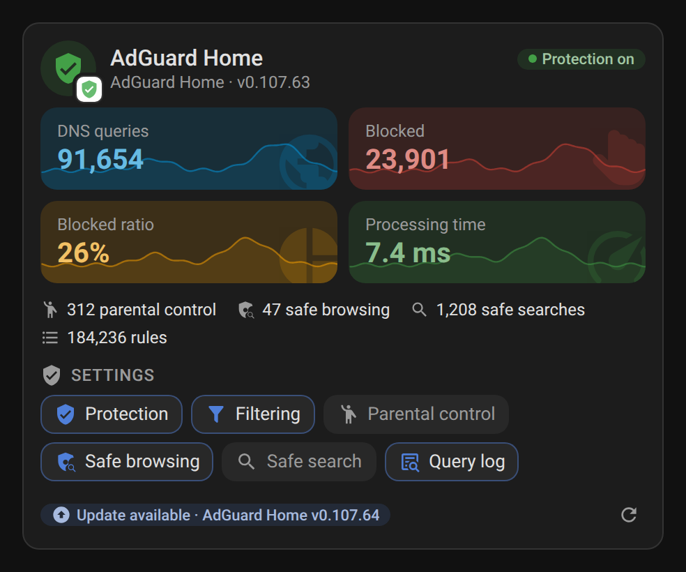 |
|  | 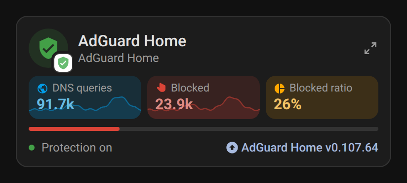 |

Mini card zoomed in with its detail button (top right, click it again or anywhere outside the card to go back):

| Light | Dark |
|---|---|
| 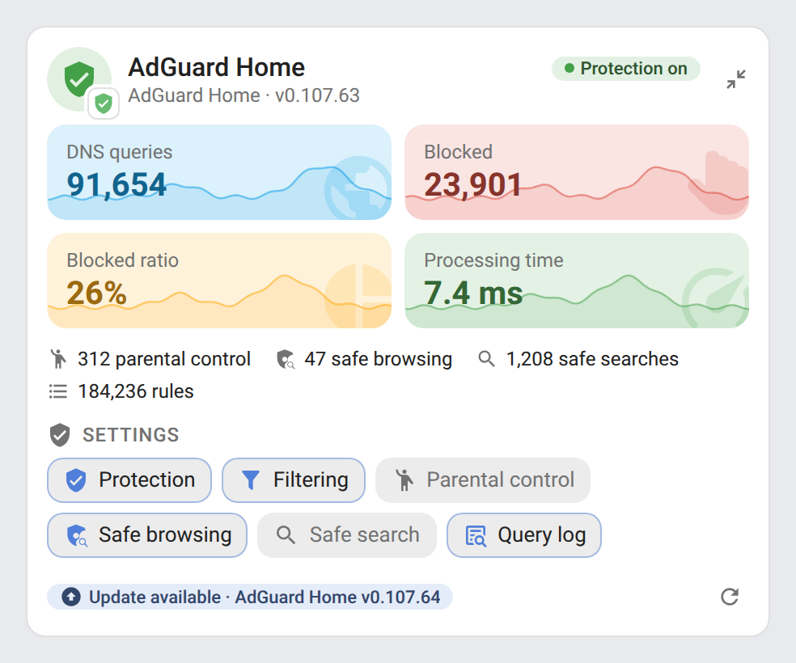 | 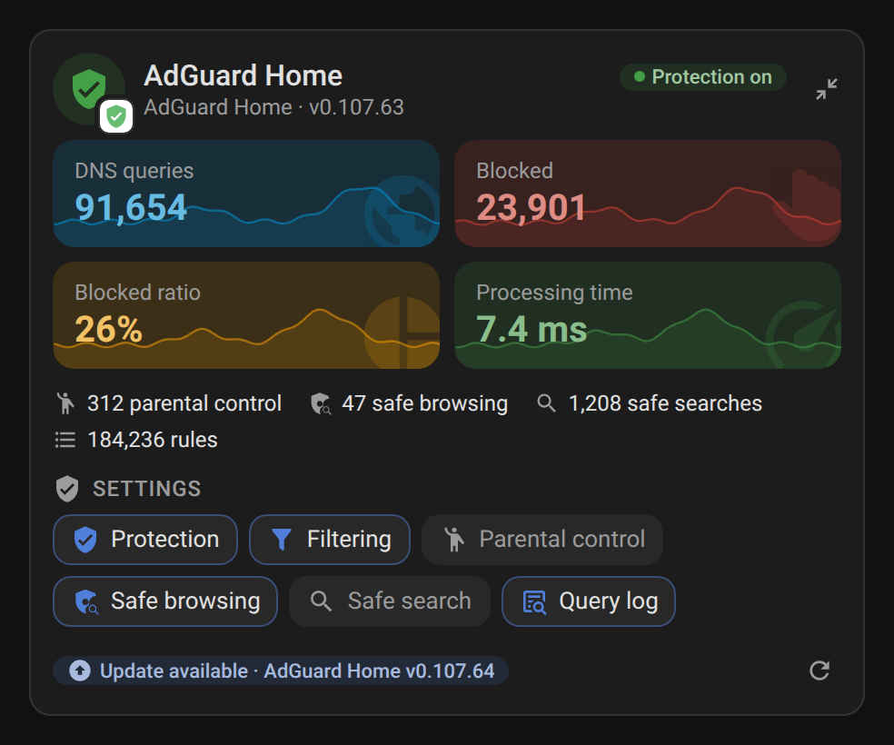 |

###  Pi-hole

| Light | Dark |
|---|---|
|  | 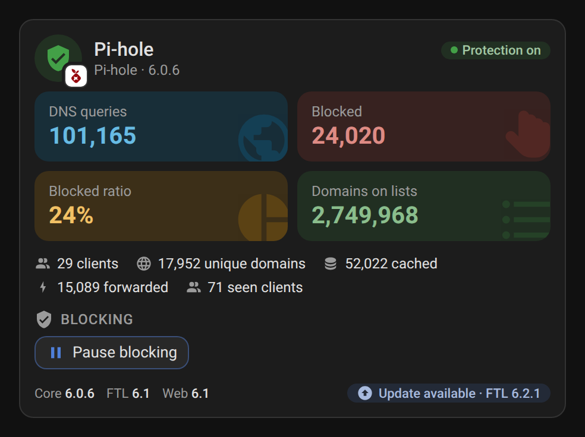 |
|  | 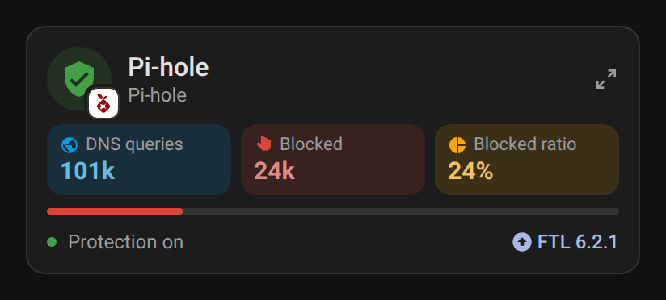 |

The pause popup, at the top of the card:

| Light | Dark |
|---|---|
| 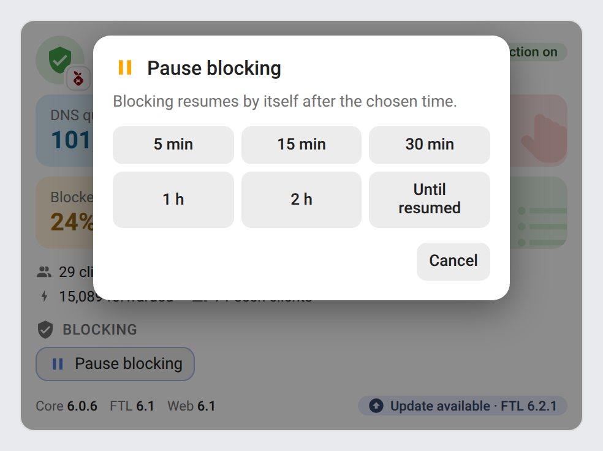 | 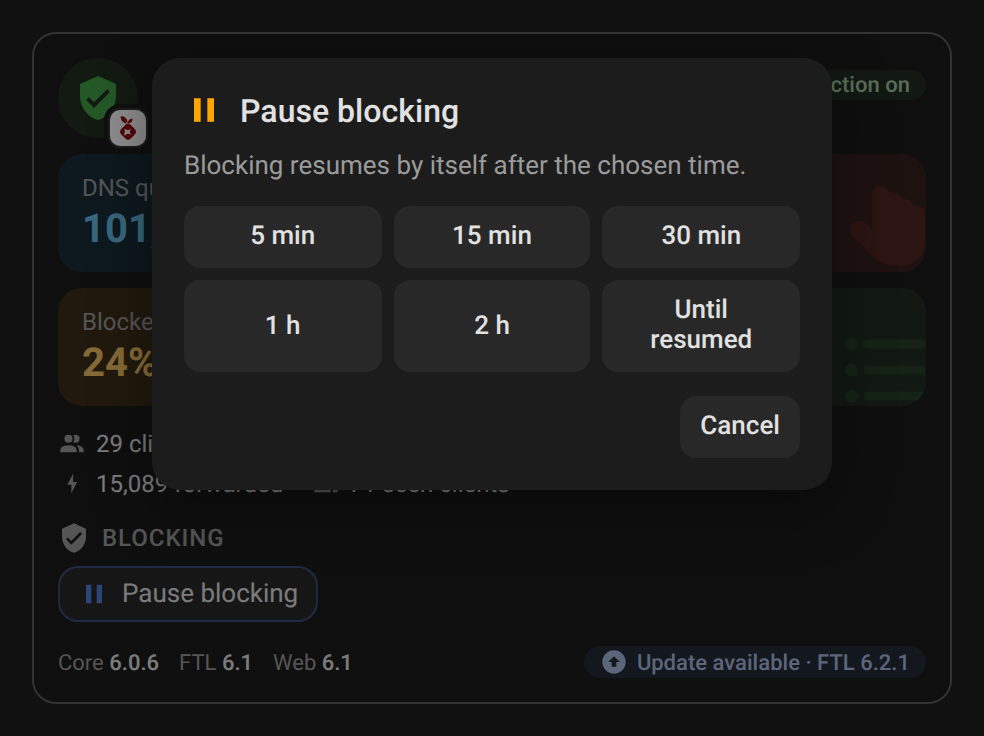 |

## How it works

The cards read the Home Assistant entity and device registries instead of entity ids: every entity of the `adguard` and `pi_hole` integrations is matched by its `translation_key` (`dns_queries`, `dns_queries_blocked_ratio`, `average_processing_speed`, `ads_blocked`, `domains_being_blocked`, `core_update_available`…) and grouped by the device it belongs to. Entity ids can therefore be in any language or renamed without breaking the cards.

- **AdGuard Home**: the status pill follows the **Protection** switch. The six switches of the integration become chips: a click calls `switch.toggle`. The refresh button at the bottom right calls the `adguard.refresh` action (filter lists, without `force`). The **Rules count** sensor is disabled by default by the integration: enable it in **Settings → Devices & services → Entities** to see it among the detail counters. The update entity of the integration shows an « Update available » chip while it is on.
- **Pi-hole**: the status pill follows the **Status** binary sensor (on = blocking). The blocking switch carries no `translation_key`: it is the one switch of the device. The pause button calls the `pi_hole.disable` action with the chosen duration (`00:30:00`…), or turns the switch off for « until resumed »; the resume button turns it on again. Pi-hole v6 renamed its counters (`dns_queries`, `ads_blocked`, `percent_ads_blocked`): the former v5 keys (`dns_queries_today`, `ads_blocked_today`, `ads_percentage_today`) are read too. The three update entities carry the installed versions of Core, FTL and the web interface, shown in the footer.

### Narrow cards

The full card fits down to 9 columns of a sections view (about 234 px on a phone), the mini card down to 6 columns (about 156 px on a phone). Below about 240 px the statistics tiles stack in one column. Below about 200 px, the status pill shrinks to its colored dot (its text stays in its tooltip). In a container sized by its content (a grid `auto` column, an inline-block wrapper), the cards take a width of 400 px instead of collapsing.

## Development

```bash
npm install
npm run build          # bundles src/dns-filter-card.js into dist/dns-filter-card.js
npm run check          # builds and checks the card (run in CI)
npm test               # unit tests (node --test)
npm run screenshots    # renders the cards with mock data (scripts/mock-states.mjs) into screenshots/
```

`dist/` is not committed: `npm run build` creates it locally, CI builds it on every push, and the release workflow attaches the built file to the release, which is where the Marketplace installs it from.

### Releasing

1. Bump `version` in `package.json`
2. Add a `## <version>` section at the top of [CHANGELOG.md](https://github.com/juju35/ha-dns-filter-card/blob/main/CHANGELOG.md)
3. Push to `main`: the **Release** workflow builds the card, creates the tag and the GitHub release with the changelog section as notes, and attaches `dns-filter-card.js`

## Translations

The cards auto-detect the language from your Home Assistant settings. Currently supported:

| Language | Code |
|---|---|
| English | `en` |
| Français | `fr` |
| Deutsch | `de` |
| Español | `es` |
| Српски (Serbian, Cyrillic) | `sr` |
| Srpski (Serbian, Latin) | `sr-Latn` |
| Italiano | `it` |
| Nederlands | `nl` |
| Português (Portugal) | `pt` |
| Polski | `pl` |
| Română | `ro` |
| Dansk | `da` |
| Svenska | `sv` |
| Български | `bg` |
| Русский | `ru` |
| Українська | `uk` |
| Magyar | `hu` |
| Slovenčina | `sk` |
| Čeština | `cs` |
| Slovenščina | `sl` |
| Latviešu | `lv` |
| Ελληνικά | `el` |

Contributions for additional languages are welcome!

## Credits

Inspired by the [AdGuard Card](https://github.com/homeassistant-extras/adguard-card) and [Pi-hole Card](https://github.com/homeassistant-extras/pi-hole-card) of homeassistant-extras. AdGuard is a trademark of AdGuard Software Ltd; Pi-hole is a registered trademark of Pi-hole LLC. The marks drawn here are simple icons, not the official logos. This project is not affiliated with AdGuard or Pi-hole.

## License

[MIT](https://github.com/juju35/ha-dns-filter-card/blob/main/LICENSE)

## Support

If you find this project useful, you can support its development:

<a href="https://buymeacoffee.com/julienstep9"></a>
